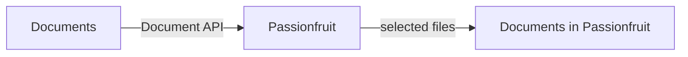
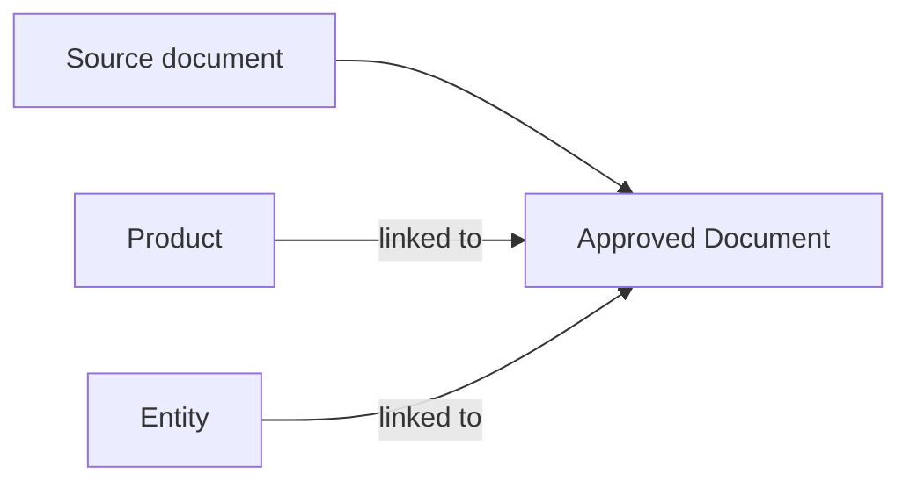
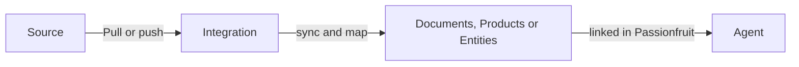
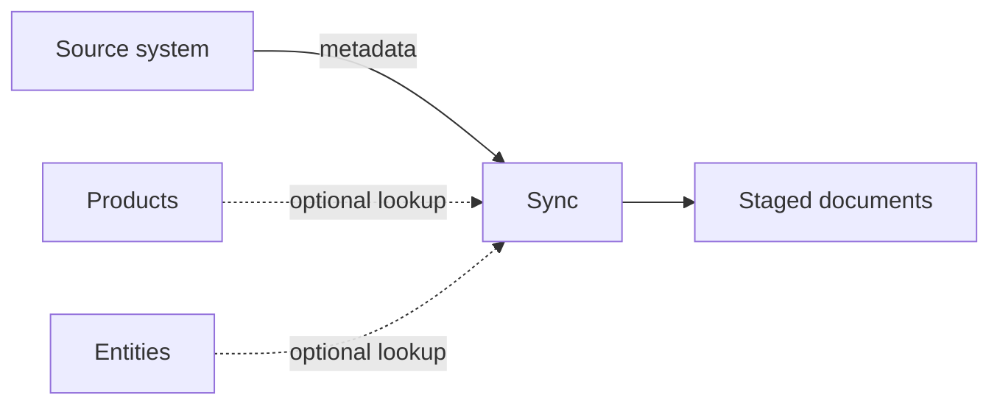
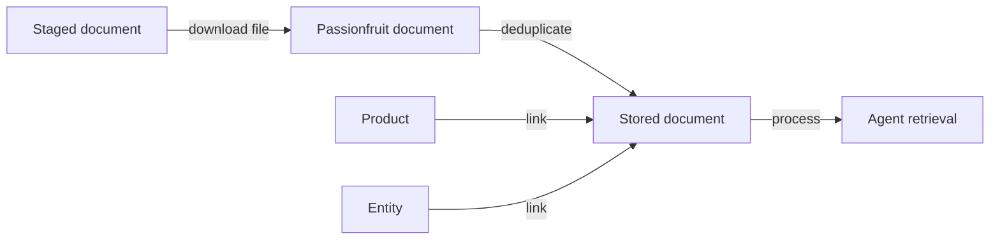

**What this is**

Passionfruit helps quality teams complete customer requests faster. Those requests can be questionnaires, document requests, product information checks, supplier questions, compliance requests, or other day-to-day quality tasks.

**System of action, not system of record**

Passionfruit is a system of action, not the system of record. Customers already maintain their documents, products, and entities in source systems such as document libraries, product databases, supplier portals, ERP exports, QMS tools, or internal platforms.

<Info>
  The customer source system remains the system of record. Passionfruit uses
  that trusted data as the context agents need to retrieve, reason, and complete
  customer requests.
</Info>

**The goal**

The goal is to keep the customer's source system as the source of truth, while giving Passionfruit access to the data it needs to perform actions. Passionfruit agents can then retrieve the right document, product, and entity context when completing quality tasks.

**After setup**

After setup, Passionfruit keeps documents, products, and entities aligned with the customer's source system. Teams do not need to manually upload every file, recreate every product, or rebuild every supplier relationship by hand.

<div className="bg-[#FDFDFD] rounded-lg flex items-center justify-center overflow-hidden outline-[0.5px] outline outline-black/10">
  
</div>

## Core Concepts

Special integrations are built around three types of source data: documents, products, and entities.

| Type      | What it means in Passionfruit                                                                                   | Why it matters                                                                 |
| --------- | --------------------------------------------------------------------------------------------------------------- | ------------------------------------------------------------------------------ |
| Documents | Files in Passionfruit, such as specifications, certificates, declarations, policies, and technical data sheets. | Documents are what Passionfruit agents retrieve to support customer requests.  |
| Products  | Products, materials, SKUs, item codes, or product IDs.                                                          | Product data lets Passionfruit handle product-specific customer requests.      |
| Entities  | Suppliers, companies, sites, factories, distributors, or other business entities.                               | Entity data links documents and tasks to the right supplier, site, or company. |

A strong setup usually has all three. Documents provide the proof, products tell us what the proof is about, and entities tell us which supplier, site, company, or other business entity the proof belongs to.

These are the data types Passionfruit understands. They are separate from the source system we connect to. For example, documents may come from Manual Masters QMS or SharePoint, products may come from a product database, and entities may come from a supplier portal or custom API.

<Info>
  Using SharePoint? See the [SharePoint integration guide](/docs/sharepoint) for
  the SharePoint-specific setup flow.
</Info>

## Common Integrations

A special integration can connect to a standard source, a customer-specific source, or a combination of sources. The important question is which Passionfruit data types the source can provide.

| Source                             | Can provide                                                        | Typical use                                                                                                                                  |
| ---------------------------------- | ------------------------------------------------------------------ | -------------------------------------------------------------------------------------------------------------------------------------------- |
| Manual Masters, Normec, QMS        | Documents                                                          | QMS documents and quality records, such as product specs, packaging documents, policies and procedures, supplier documents, and lab results. |
| SharePoint, Google Drive, OneDrive | Documents, sometimes product and entity references                 | Existing document libraries with specifications, certificates, declarations, and other quality documents.                                    |
| Product database, PIM, ERP, or PLM | Products, sometimes entities and documents                         | Product master data, item codes, material numbers, product attributes, and product ownership.                                                |
| MS Fabric                          | Products, documents, and entities, depending on the customer setup | Structured product, document, or entity data made available through the customer's data platform.                                            |
| Supplier Management Software       | Entities and documents                                             | Supplier profiles, supplier certificates, declarations, and uploaded supplier documents.                                                     |
| Custom API                         | Documents, products, and entities                                  | Customer-owned systems where we can read the required data through an API.                                                                   |
| File export or spreadsheet         | Products, entities, or document metadata                           | A lightweight starting point when there is no API yet, or when the first version should stay simple.                                         |

One source does not need to provide everything. We can combine sources as long as there is a stable way to connect documents to the right products and entities.

## Flexible data mapping

Passionfruit uses a simple core model: documents, products, and entities. For each type, we only need the minimum stable fields required to identify, sync, and link the records.

Everything around that core can stay flexible. Different systems use different field names, attributes, and levels of detail, so we map customer-specific data into Passionfruit without asking every customer to reshape their source system first.

This means the integration can follow the customer's existing structure. We can store extra source fields as flexible metadata when they help with retrieval, filtering, traceability, or task completion.

## Authentication Methods

Passionfruit authenticates to the customer's source system server-to-server.

- HTTP header authentication, for example `Authorization: Bearer <token>`
- Custom authentication depending on target source

## Data sources

Each special integration can use one, two, or all three of these data types.

### 1. Documents

<div className="bg-[#FDFDFD] rounded-lg flex items-center justify-center overflow-hidden outline-[0.5px] outline outline-black/10">
  
</div>

Documents are often the base. Passionfruit can use a Document API, SharePoint library, export, or another source to list files, read file metadata, and download selected files.

Examples of documents:

- Product specifications
- Technical data sheets
- Allergen declarations
- Non-GMO statements
- Certificates
- Supplier declarations
- Quality or sustainability documents

**Document API**



Recommended fields for each source document:

```json
{
  "documentId": "DOC-100245",
  "filename": "604833_SDS_EN_20170606.pdf",
  "fileType": "pdf",
  "lastModified": "2026-06-17T08:24:49.379Z",
  "downloadUrl": "https://source.example.com/files/100245/content",
  "itemCode": "506.00086",
  "entityReference": "210028",
  "documentType": "Safety data sheet",
  "attributes": {}
}
```

| Field                          | Required             | Purpose                                                                  |
| ------------------------------ | -------------------- | ------------------------------------------------------------------------ |
| Document ID                    | Yes                  | Stable unique ID from the source system.                                 |
| Filename                       | Yes                  | Used as the document name in Passionfruit.                               |
| File type                      | Yes                  | Used to filter supported documents.                                      |
| Last modified timestamp        | Yes                  | Used for incremental sync.                                               |
| Download URL or download ID    | Yes                  | Used to fetch the file during move.                                      |
| Item code or product reference | Strongly recommended | Used to create or match products.                                        |
| Entity reference               | Strongly recommended | Used to look up and link suppliers, sites, companies, or other entities. |
| Document type                  | Recommended          | Example: specification, certificate, declaration, technical data sheet.  |

Supported file types for the first version:

- `.pdf`
- `.doc`
- `.docx`
- `.xlsx`

### 2. Products

<div className="bg-[#FDFDFD] rounded-lg flex items-center justify-center overflow-hidden outline-[0.5px] outline outline-black/10">
  
</div>

Products give Passionfruit product context. We can use a Product API, product database, export, item codes, SKUs, material numbers, or product IDs to create or match product records.

Examples of product details:

- Item code
- Product ID
- Product name
- Product group
- Process type
- Entity reference
- Description
- Customer-specific product attributes


**Products API**

```json
{
  "itemCode": "400.00010",
  "productName": "Unifiber Soy",
  "entityReference": "210552",
  "productGroup": "Fibers",
  "processType": "Blended",
  "description": "Soy-based functional fiber",
  "attributes": {
    "origin": "EU",
    "allergen": "soy"
  }
}
```

Recommended fields for each product:

| Field                   | Required    | Purpose                                                      |
| ----------------------- | ----------- | ------------------------------------------------------------ |
| Item code or product ID | Yes         | Stable key for matching products.                            |
| Product name            | Recommended | Display name in Passionfruit.                                |
| Entity reference        | Recommended | Helps link the product to a supplier, site, or other entity. |
| Product group           | Optional    | Stored as product metadata.                                  |
| Process type            | Optional    | Stored as product metadata.                                  |
| Description             | Optional    | Stored as product metadata.                                  |
| Additional attributes   | Optional    | Stored flexibly for future use.                              |

The exact product fields can vary by customer. We can carry source-specific attributes without changing the overall integration flow.

### 3. Entities

<div className="bg-[#FDFDFD] rounded-lg flex items-center justify-center overflow-hidden outline-[0.5px] outline outline-black/10">
  
</div>

Entities give Passionfruit business-entity context. We can use an Entity API, supplier portal, export, or another source to create or match entities. In Passionfruit, a supplier is one type of entity. Entities can also represent companies, sites, factories, distributors, or other business units.

Examples of entity details:

- Entity ID
- Entity code
- Entity name
- Entity type, such as supplier, site, factory, distributor, or company
- Site or factory name
- Country
- Address
- Customer-specific entity attributes


**Entities API**

```json
{
  "entityId": "cc5b1dbc-ce77-4346-87ca-393bfb0816a1",
  "entityCode": "210552",
  "entityName": "Raps bv",
  "entityType": "supplier",
  "country": "NL",
  "address": "Industrieweg 12, 1234 AB",
  "attributes": {
    "vatNumber": "NL000000000B01",
    "contactEmail": "quality@raps.example.com"
  }
}
```

Required and recommended fields for each entity. A supplier is one type of entity.

| Field                 | Required    | Purpose                                                 |
| --------------------- | ----------- | ------------------------------------------------------- |
| Entity name           | Yes         | Used to create or match the entity.                     |
| Entity ID             | Yes         | Stable external key used to create or match the entity. |
| Entity code           | Recommended | Customer-facing supplier, site, or company reference.   |
| Entity type           | Recommended | Example: supplier, site, factory, distributor, company. |
| Country               | Optional    | Stored as entity metadata.                              |
| Address               | Optional    | Stored as entity metadata.                              |
| Additional attributes | Optional    | Stored flexibly for future use.                         |

If entity lookup fails for one document, Passionfruit can still stage the document and retry enrichment later. One failed entity lookup does not block the full sync.

## Tagging

The strongest setup is a combined integration where products and entities are connected to documents inside Passionfruit. The source document becomes an approved document, and that document is linked to the right product and entity.

In Passionfruit, those links are visible from the document or evidence detail view. A user can open the document and click through to the connected products and entities, so the relationship is easy to inspect and verify.

<div className="bg-[#FDFDFD] rounded-lg flex items-center justify-center overflow-hidden outline-[0.5px] outline outline-black/10">
  
</div>

<br></br>


This means a user can ask Passionfruit to complete a customer request for a product, supplier, site, or company and Passionfruit can look at:

- Documents linked to the product
- Documents linked to the entity, such as a supplier, site, or company
- Reusable knowledge linked to the product or entity
- Any extra product or entity metadata we imported

## How we sync

### Step 1: Trigger sync

Most of our integrations are pull-based. Passionfruit connects to the customer's source system and reads the data on a schedule. The source system does not need to call Passionfruit.

Push is also possible in specific setups, but it is usually not the first choice. In a push setup, the customer sends files or records to a Passionfruit endpoint or agreed storage location.



| Approach | How it works                                          | When we use it                                                                                                         |
| -------- | ----------------------------------------------------- | ---------------------------------------------------------------------------------------------------------------------- |
| Pull     | Passionfruit reads from the customer's source system. | Default for SharePoint, Manual Masters QMS, Fabric, product databases, supplier portals, exports, and custom APIs.     |
| Push     | The customer sends records or files to Passionfruit.  | Only when the customer cannot expose a readable source, or when their system is already built around pushing data out. |

For most customers, pull is simpler: Passionfruit controls the sync schedule, handles retries, and can re-read data when something needs to be fixed.

### Step 2: Sync and map

During sync, Passionfruit reads document metadata from the source system.

At this stage we do not copy the file content yet. We only store the information needed to decide whether a document should be imported.

For product-only or entity-only integrations, sync is simpler: Passionfruit reads the changed records and creates or updates the matching products or entities. There may be no move step, because there is no file content to download.



During sync, Passionfruit can:

- Page through the source document list.
- Filter for supported file types.
- Read document metadata such as document ID, filename, file type, item code, entity reference, and last modified timestamp.
- Look up entity details when an entity reference is available.
- Look up product details when product metadata is available.
- Stage matching documents for review or import.
- Avoid duplicate staged documents by using the source document ID.

### Step 3: Download and review

During review, Passionfruit imports selected staged documents. **Review is only needed when the integration imports files**. If the integration only updates products or entities, the sync can update those records directly.



During move, Passionfruit can:

- Download the selected file from the source system.
- Check whether the same file already exists in Passionfruit.
- Create or match the entity.
- Create or match the product.
- Store the file as an approved document.
- Link the document to the right entity and product.
- Process the document so it can be retrieved by Passionfruit agents for customer requests and quality tasks.

## Keeping data in sync

### Sync Schedule

The first sync is a full read of the supported records in scope. For document integrations, that usually means document metadata first, not file content.

After that, Passionfruit uses incremental sync. We store a watermark, usually the latest source timestamp or cursor from the previous successful sync. Future syncs request only records changed after that watermark.

| Phase        | Behavior                                                   |
| ------------ | ---------------------------------------------------------- |
| First sync   | Reads all supported records and establishes the watermark. |
| Ongoing sync | Reads only new or updated records.                         |
| Manual sync  | Can be triggered for setup, support, or reprocessing.      |

The sync frequency is configurable. Common options are every 15 minutes, hourly, or daily.

### Deduplication

The integration deduplicates at multiple levels:

| Level                    | Method                                                  | Result                                                      |
| ------------------------ | ------------------------------------------------------- | ----------------------------------------------------------- |
| Source document          | Stable source document ID                               | The same source document is staged once.                    |
| File content             | File checksum                                           | The same file is not imported as a duplicate document.      |
| Product or entity record | Stable product ID, item code, entity ID, or entity code | The same product or entity is updated instead of recreated. |

If the same file is linked to multiple item codes, Passionfruit can stage it once and preserve all related product references in the metadata.

### Reliability

Passionfruit calls the source system defensively.

| Behavior           | Default                                                     |
| ------------------ | ----------------------------------------------------------- |
| Request timeout    | 15 seconds per request.                                     |
| Retries            | Up to 2 retries for transient failures.                     |
| Retry status codes | `408`, `429`, `500`, `502`, `503`, `504`.                   |
| Error isolation    | One bad file or record does not block the rest of the sync. |

Connection-level errors are recorded on the integration. Document-specific or record-specific errors are recorded on the affected staged document, product, or entity.
