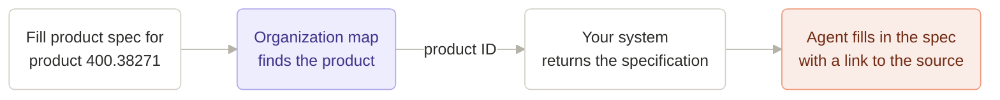

Passionfruit works with the systems you already have. There is nothing to migrate and nothing to enter twice. Your systems stay the source of truth, and Passionfruit connects to them to find the right information and complete quality work: questionnaires, document requests, product checks, supplier questions, and more.

## How it works

<div className="bg-[#FDFDFD] rounded-lg flex items-center justify-center overflow-hidden outline-[0.5px] outline outline-black/10 p-4">
  
</div>

<CardGroup cols={3}>
  <Card title="Organization map" icon="sitemap" href="#organization-map">
    Passionfruit knows how your company is organized: your products,
    customers, suppliers, and sites.
  </Card>
  <Card title="Integration layer" icon="network-wired" href="#intelligent-integration-layer">
    The agent learns where your information lives and how to fetch it.
  </Card>
  <Card title="Your systems" icon="server" href="#your-systems">
    Integration library, custom integrations, and your DMS. Connected, not
    copied.
  </Card>
</CardGroup>

## Organization map

The organization map is how Passionfruit knows your company. It needs only two lists.

| List                 | Minimum fields     | Examples                                    |
| -------------------- | ------------------ | ------------------------------------------- |
| Entities             | ID, name, type     | Customers, suppliers, sites, manufacturers. |
| Products or articles | ID, name, group    | Finished products, raw materials, SKUs.     |

That is all. Passionfruit reads these lists from your system and keeps them up to date automatically. No API yet? Start with a CSV or Excel export.

The map is what makes everything else work:

- **Everything is organized.** Every document is linked to the products, customers, and suppliers it belongs to.
- **Always the right item.** Each task is tied to the exact ID from your system, so Passionfruit never mixes up two similar products.
- **The key to your information.** That same ID is how Passionfruit asks your systems for the details.

<div className="bg-[#FDFDFD] rounded-lg flex items-center justify-center overflow-hidden outline-[0.5px] outline outline-black/10">
  
</div>

**Technical details**

<AccordionGroup>
  <Accordion title="How the map is filled" icon="sitemap">
    Passionfruit reads two lists from your system: entities (customers, suppliers, sites) and products. Usually this is a list endpoint, such as _list entities_ and _list products_. A CSV or Excel export works too, to get started.

    Only the minimum is needed. Field names can differ in your system; we map them for you.

    ```json
    { "entityId": "210552", "entityName": "Raps bv", "entityType": "supplier" }
    ```

    ```json
    { "itemCode": "400.00010", "productName": "Unifiber Soy", "productGroup": "Fibers" }
    ```

    | List     | Required   | Recommended |
    | -------- | ---------- | ----------- |
    | Entities | ID, name   | Type        |
    | Products | ID, name   | Group       |
  </Accordion>

  <Accordion title="Sync schedule" icon="clock">
    The map is updated on a schedule, for example four times a day. The first sync reads all products and entities. After that, Passionfruit only reads what changed, and updates existing records instead of creating duplicates, based on their ID.
  </Accordion>
</AccordionGroup>

## Intelligent integration layer

Your information is spread across systems: specifications in your ERP or data platform, certificates in your quality system, signed questionnaires in SharePoint. The integration layer knows where each piece of information lives, and how to get it.

When a task needs information, the agent finds the product or supplier in the organization map, then fetches the details from the right system using that ID. For example:



### How the integration layer works

The agent is what does the work. It reads the task, decides which information it needs, and asks for it. The integration layer makes sure that question reaches the right system, in the right way, within your rules. Every request passes through these layers.

<div className="bg-[#FDFDFD] rounded-lg flex items-center justify-center overflow-hidden outline-[0.5px] outline outline-black/10 p-4">
  
</div>

<Steps>
  <Step title="Capabilities: what the agent can do">
    The agent never talks to a system directly. It uses a fixed set of capabilities, such as _search products_, _read supplier_, _get specification_, or _read document_. When you allow it, also write actions, such as _update a supplier record_ or _save a completed document_. The same capabilities work for every system.
  </Step>
  <Step title="Configuration: how it is set up for you">
    Your setup tells the agent which source to use for what, and how. Which system holds specifications and which holds certificates, which fields to use, and which source wins when two disagree. For example: in MS Fabric, use the external tolerance limits, not the internal ones. In SharePoint, only include certified documents, and use the **Customer** column to link each document to a customer. We configure this together with you, and adjust it as we learn how your team works.
  </Step>
  <Step title="Authorization: who may see and do what">
    Your own rules always apply. Access follows your permissions, for example in Microsoft Entra ID, so the agent only sees what you allow. Write actions follow your approval flow: nothing is changed in your systems until someone on your team approves it.
  </Step>
  <Step title="Integrations: your systems, plugged in">
    Each of your systems plugs into Passionfruit through an integration: from the [integration library](#integration-library), a [custom integration](#custom-integrations), or your [DMS](#document-management-system-dms). The integration logs in, calls your system, and turns the answer into products, entities, and documents that Passionfruit understands.
  </Step>
</Steps>

<Info>
  Documents from your DMS work a little differently. They are synced in the background, without the agent, so they are ready before a task starts. During a task, the agent searches the synced documents instead of opening your DMS. [How the DMS sync works](#document-management-system-dms)
</Info>

**It gets better over time**

When your team corrects an answer or points to a better source, we use that to refine your configuration. So the more your team uses Passionfruit, the better it gets at finding information the way you would. And because workflows only use capabilities, adding a new system later doesn't change how anything works. It just becomes another place the agent can look.

## Your systems

Passionfruit connects to the systems you already use, in three ways. Every setup starts with your [organization map](#organization-map), which can come from any of your systems or from a CSV or Excel export. Each integration then adds the information you need.

<CardGroup cols={3}>
  <Card title="Integration library" icon="plug" href="#integration-library">
    Ready-made integrations for quality and supplier platforms.
  </Card>
  <Card title="Custom integrations" icon="screwdriver-wrench" href="#custom-integrations">
    Your own data platforms, ERP, and internal APIs.
  </Card>
  <Card title="DMS" icon="folder-open" href="#document-management-system-dms">
    Document management systems such as SharePoint and Google Drive.
  </Card>
</CardGroup>

### Integration library

Ready-made integrations for the quality and supplier platforms used across the food industry. You give us access, and we connect your account.

<div className="flex flex-wrap items-center gap-3 my-6">
  <div className="flex items-center justify-center h-16 px-6 rounded-lg border border-black/10 bg-white">
    
  </div>
  <div className="flex items-center justify-center h-16 px-6 rounded-lg border border-black/10 bg-white">
    
  </div>
  <div className="flex items-center justify-center h-16 px-6 rounded-lg border border-black/10 bg-white">
    
  </div>
  <span className="px-4 py-2 text-gray-500 dark:text-gray-400 font-medium">+ more</span>
</div>

Don't see your platform? Let us know at `hello@passionfruit.earth`. We add new integrations to the library all the time.

### Custom integrations

Every company has its own systems: a data platform like MS Fabric, an ERP like Microsoft Dynamics, a PLM, or an internal API. With a custom integration, Passionfruit works with them just as well.

You tell us which information you want to use and where it lives, such as product specifications, packaging, or orders. We connect to it and teach the agent how your systems are structured, so it always fetches the right information.

<Card title="Custom integrations" icon="screwdriver-wrench" href="/docs/custom-integrations" horizontal>
  How we set up a custom integration together with you.
</Card>

**Technical details**

<AccordionGroup>
  <Accordion title="How information is fetched" icon="bolt">
    Details such as specifications, packaging, or orders are not copied in advance. When a task needs them, the agent looks up the product or entity in your organization map, and fetches the details from your system using that ID. For example `GET /products/{itemCode}/specification`.

    For the integration library, these calls are built in. For custom integrations, any endpoint that returns information by product or entity ID works. There is no fixed format: we map your response and teach the agent which endpoint holds which information.
  </Accordion>

  <Accordion title="Documents from a custom system" icon="file-code">
    When documents come from your own system instead of a DMS, Passionfruit reads a document list and downloads the files.

    ```json
    {
      "documentId": "DOC-100245",
      "filename": "604833_SDS_EN_20170606.pdf",
      "lastModified": "2026-06-17T08:24:49.379Z",
      "downloadUrl": "https://source.example.com/files/100245/content",
      "itemCode": "400.00010",
      "entityId": "210552"
    }
    ```

    The ID, filename, last modified date, and download URL are required. The item code and entity ID link the document to your organization map.
  </Accordion>
</AccordionGroup>

### Document management system (DMS)

Connect the document management system you already use, such as SharePoint or Google Drive. Passionfruit adds your documents, indexes them, and keeps them in sync, so they are ready the moment you start a task.

Quality documents are often heavy: long PDFs, Excel files with many tabs, presentations, and emails, in all kinds of formats. Opening and reading them while a task runs would be slow. Because everything is indexed up front, the agent searches thousands of documents in seconds and uses the right part of the right file.

Your DMS stays the source of truth. Passionfruit never edits or deletes your files.

<CardGroup cols={2}>
  <Card title="SharePoint" icon="microsoft" href="/docs/sharepoint">
    Connect a site or folder with Microsoft Entra ID.
  </Card>
  <Card title="Google Drive" icon="google-drive" href="/docs/google-drive">
    Share a folder with your custom Passionfruit email address.
  </Card>
</CardGroup>

**How the sync works**

1. **You choose what to share.** A site, library, or folder, and if you want, which document types or statuses to include.
2. **We do a first full sync.** Every document in scope is imported, linked to the right products, customers, and suppliers, and made searchable for the agent.
3. **After that, changes come in automatically.** When a file is added or changed, your DMS lets Passionfruit know, and we sync just that change. Updated files are saved as a new version, so the history is kept.

Your own metadata, such as columns and labels in SharePoint, comes along with each document, and can also be used to create and match products and entities in your organization map.

<div className="bg-[#FDFDFD] rounded-lg flex items-center justify-center overflow-hidden outline-[0.5px] outline outline-black/10">
  
</div>

Supported file types: PDF (`.pdf`), Word (`.docx`, `.doc`), Excel (`.xlsx`, `.xls`), PowerPoint (`.pptx`, `.ppt`), and email (`.eml`, `.msg`).

**Technical details**

<AccordionGroup>
  <Accordion title="When a sync is triggered" icon="bell">
    | DMS          | Trigger                                                                                                                                  |
    | ------------ | ---------------------------------------------------------------------------------------------------------------------------------------- |
    | SharePoint   | A Microsoft Graph webhook notifies Passionfruit when something changes, and Passionfruit fetches just the changes. As a safety net, Passionfruit also checks for changes every 15 minutes. The webhook subscription is renewed automatically. |
    | Google Drive | Passionfruit reads the Google Drive changes since the last sync, for the folders shared with your custom Passionfruit email address. |

    You can also trigger a sync manually, for setup, support, or reprocessing.
  </Accordion>

  <Accordion title="Sync steps" icon="arrows-rotate">
    1. **Read metadata.** Passionfruit reads metadata such as document ID, filename, file type, folder path, your own columns, and last modified date. File content is not copied yet.
    2. **Import.** Documents in scope are downloaded, converted when needed, and checked for duplicates. Depending on the setup, your team can review them first.
    3. **Link and process.** Each document is linked to the right products and entities in your organization map, and processed so the agent can search it.
  </Accordion>

  <Accordion title="Metadata mapping" icon="tags">
    Your own metadata comes along with each document. In SharePoint, you choose which list columns to include.

    Columns or your folder structure can also be used to fill your [organization map](#organization-map): the list of your products, customers, suppliers, and sites that Passionfruit uses to organize everything. Each document is then matched to the right product or entity, and new ones are created when they don't exist yet. For example, a **Customer** column or a folder per supplier is enough to link every document to the right customer or supplier.
  </Accordion>

  <Accordion title="Deduplication and versions" icon="clone">
    | Level           | Method                    | Result                                 |
    | --------------- | ------------------------- | -------------------------------------- |
    | Source document | Stable source document ID | The same document is imported once.    |
    | File content    | File checksum             | The same file is not imported twice.   |

    When a file changes, the new file is saved as a new version. The old version stays in the history.
  </Accordion>

  <Accordion title="File types and limits" icon="file">
    | Type       | Extensions      | Handling                        |
    | ---------- | --------------- | ------------------------------- |
    | PDF        | `.pdf`          | Stored as is.                   |
    | Word       | `.docx`, `.doc` | `.doc` is converted to `.docx`. |
    | Excel      | `.xlsx`, `.xls` | `.xls` is converted to `.xlsx`. |
    | PowerPoint | `.pptx`, `.ppt` | Converted to PDF.               |
    | Email      | `.eml`, `.msg`  | Read as email.                  |

    Files can be up to 150 MB. Files that are too large or of another type are skipped and reported.
  </Accordion>
</AccordionGroup>

## Security

- **Read-only by default.** Passionfruit only writes to your systems when you grant write access, and write actions can require approval by your team.
- **Only what you share.** Passionfruit only sees the lists, folders, and systems you connect.
- **Your authentication.** Connections run server-to-server, using app registration (for example Microsoft Entra ID), API tokens, or the method your system requires.
- **Built to be reliable.** Failed requests are retried, and one bad file or record never blocks the rest.

**Technical details**

<AccordionGroup>
  <Accordion title="Authentication" icon="key">
    Passionfruit connects to your systems server-to-server. Your team never has to share personal passwords.

    - **App registration**, for example in Microsoft Entra ID for SharePoint. Your existing policies, such as conditional access, keep applying.
    - **HTTP header authentication**, for example `Authorization: Bearer <token>`.
    - **Folder sharing** with a custom Passionfruit email address, for Google Drive.
    - **Custom authentication**, depending on the source system.

    Access is read-only by default. Write access is only used when you grant it.
  </Accordion>

  <Accordion title="What is stored where" icon="database">
    | Data                          | Where it lives                                                                                               |
    | ----------------------------- | ------------------------------------------------------------------------------------------------------------ |
    | Organization map              | Stored in Passionfruit: IDs, names, and a few key attributes per product and entity.                         |
    | Information from your systems | Fetched from your system when a task needs it, and used for that task.                                       |
    | Documents                     | Synced to Passionfruit: the file, its metadata, and processed content for search. Your DMS stays the source. |
  </Accordion>

  <Accordion title="Reliability" icon="shield-check">
    | Behavior           | Default                                                     |
    | ------------------ | ----------------------------------------------------------- |
    | Request timeout    | 15 seconds per request.                                     |
    | Retries            | Up to 2 retries for temporary failures.                     |
    | Retry status codes | `408`, `429`, `500`, `502`, `503`, `504`.                   |
    | Error isolation    | One bad file or record does not block the rest of the sync. |

    Connection errors are shown on the integration. Errors for a single document, product, or entity are recorded on that record.
  </Accordion>
</AccordionGroup>

## Getting started

<Steps>
  <Step title="Tell us your systems">
    Which systems hold your products, suppliers, documents, and details.
  </Step>
  <Step title="Share access">
    Your entity and product lists, plus access to the systems and folders
    with the information you want to use.
  </Step>
  <Step title="We connect and teach the agent">
    We configure the integrations and teach the agent how your company is
    organized.
  </Step>
  <Step title="Test with real tasks">
    Your team checks the results on real work before going live.
  </Step>
</Steps>
