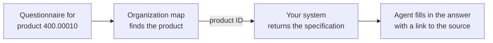

Passionfruit works with the systems you already have. There is nothing to migrate and nothing to enter twice. Your systems stay the source of truth, and Passionfruit connects to them to find the right information and complete quality work: questionnaires, document requests, product checks, supplier questions, and more.

## How it works

  

<CardGroup cols={3}>
  <Card title="Organization map" icon="sitemap" href="#organization-map">
    Passionfruit knows how your company is organized: your products,
    customers, suppliers, and sites.
  </Card>
  <Card title="Integration layer" icon="network-wired" href="#intelligent-integration-layer">
    The agent learns where your information lives and how to fetch it.
  </Card>
  <Card title="Your systems" icon="server" href="#your-systems">
    Integration library, custom integrations, and your DMS. Connected, not
    copied.
  </Card>
</CardGroup>

## Organization map

The organization map is how Passionfruit knows your company. It needs only two lists.

| List                 | Minimum fields     | Examples                                    |
| -------------------- | ------------------ | ------------------------------------------- |
| Entities             | ID, name, type     | Customers, suppliers, sites, manufacturers. |
| Products or articles | ID, name, group    | Finished products, raw materials, SKUs.     |

That is all. Passionfruit reads these lists from your system and keeps them up to date automatically. No API yet? Start with a CSV or Excel export.

The map is what makes everything else work:

- **Everything is organized.** Every document is linked to the products, customers, and suppliers it belongs to.
- **Always the right item.** Each task is tied to the exact ID from your system, so Passionfruit never mixes up two similar products.
- **The key to your information.** That same ID is how Passionfruit asks your systems for the details.

  

## Intelligent integration layer

Your information is spread across systems: specifications in your ERP or data platform, certificates in your quality system, signed questionnaires in SharePoint. The integration layer knows where each piece of information lives, and how to get it.

When a task needs information, the agent finds the product or supplier in the organization map, then fetches the details from the right system using that ID. For example:

The agent learns how to work with your systems. For the integration library this works out of the box. For custom integrations, we teach the agent how your system is structured. The more your team uses Passionfruit, the better it gets at finding information the way you would.

## Your systems

<CardGroup cols={3}>
  <Card title="Integration library" icon="plug">
    Ready-made integrations for quality and supplier platforms, such as
    TraceGains and Manual Masters. Available out of the box.
  </Card>
  <Card title="Custom integrations" icon="screwdriver-wrench">
    Your own data platforms, ERP, and internal APIs, such as MS Fabric and
    Microsoft Dynamics.
  </Card>
  <Card title="DMS" icon="folder-open">
    Document management systems such as SharePoint and Google Drive. Synced and
    organized.
  </Card>
</CardGroup>

**What we need from you**

Every setup starts with your [organization map](#organization-map). It can come from any of your systems, or from a CSV or Excel export. With the map in place, each integration adds the information you need.

| Type                | What you provide                                                                                                                                          |
| ------------------- | --------------------------------------------------------------------------------------------------------------------------------------------------------- |
| Integration library | Access to the platform. We configure the connection.                                                                                                      |
| Custom integrations | Access to the information you want to use, such as product specifications, packaging, or orders. You tell us where each type of information lives, and we teach the agent. |
| DMS                 | Access to the folders or libraries you want to include.                                                                                                   |

**Setup guides**

<CardGroup cols={2}>
  <Card title="SharePoint" icon="microsoft" href="/docs/sharepoint">
    Connect a SharePoint site or folder with Microsoft Entra ID, step by step.
  </Card>
  <Card title="Custom integrations" icon="screwdriver-wrench" href="/docs/custom-integrations">
    Connect your own data platform, ERP, or internal API.
  </Card>
  <Card title="Google Drive" icon="google-drive" href="/docs/google-drive">
    Share a folder with Passionfruit and keep your documents in sync.
  </Card>
  <Card title="Syncing documents" icon="arrows-rotate" href="/docs/knowledge-base/evidence-sync">
    Review, assign, and import files from connected sources.
  </Card>
  <Card title="Single Sign-On" icon="key" href="/docs/installation/sso">
    Let your team sign in with their work account.
  </Card>
</CardGroup>

### Documents

Documents from your DMS are synced and kept in sync. Your DMS stays the source of truth: new and changed files are picked up automatically, and Passionfruit never edits or deletes your files. You choose which folders, document types, or statuses are included.

We sync your documents so the agent can find what it needs right away, without you having to search for files or pick them yourself.

  

Supported file types: PDF (`.pdf`), Word (`.docx`, `.doc`), Excel (`.xlsx`, `.xls`), and PowerPoint (`.pptx`).

## Security

- **Read-only by default.** Passionfruit only writes to your systems when you grant write access, and write actions can require approval by your team.
- **Only what you share.** Passionfruit only sees the lists, folders, and systems you connect.
- **Your authentication.** Connections run server-to-server, using app registration (for example Microsoft Entra ID), API tokens, or the method your system requires.
- **Built to be reliable.** Failed requests are retried, and one bad file or record never blocks the rest.

## Getting started

<Steps>
  <Step title="Tell us your systems">
    Which systems hold your products, suppliers, documents, and details.
  </Step>
  <Step title="Share access">
    Your entity and product lists, plus access to the systems and folders
    with the information you want to use.
  </Step>
  <Step title="We connect and teach the agent">
    We configure the integrations and teach the agent how your company is
    organized.
  </Step>
  <Step title="Test with real tasks">
    Your team checks the results on real work before going live.
  </Step>
</Steps>
